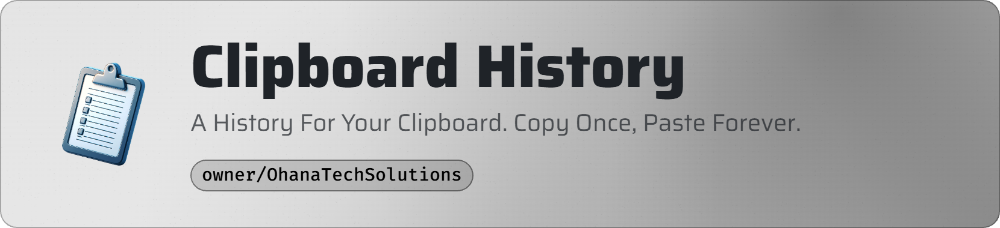
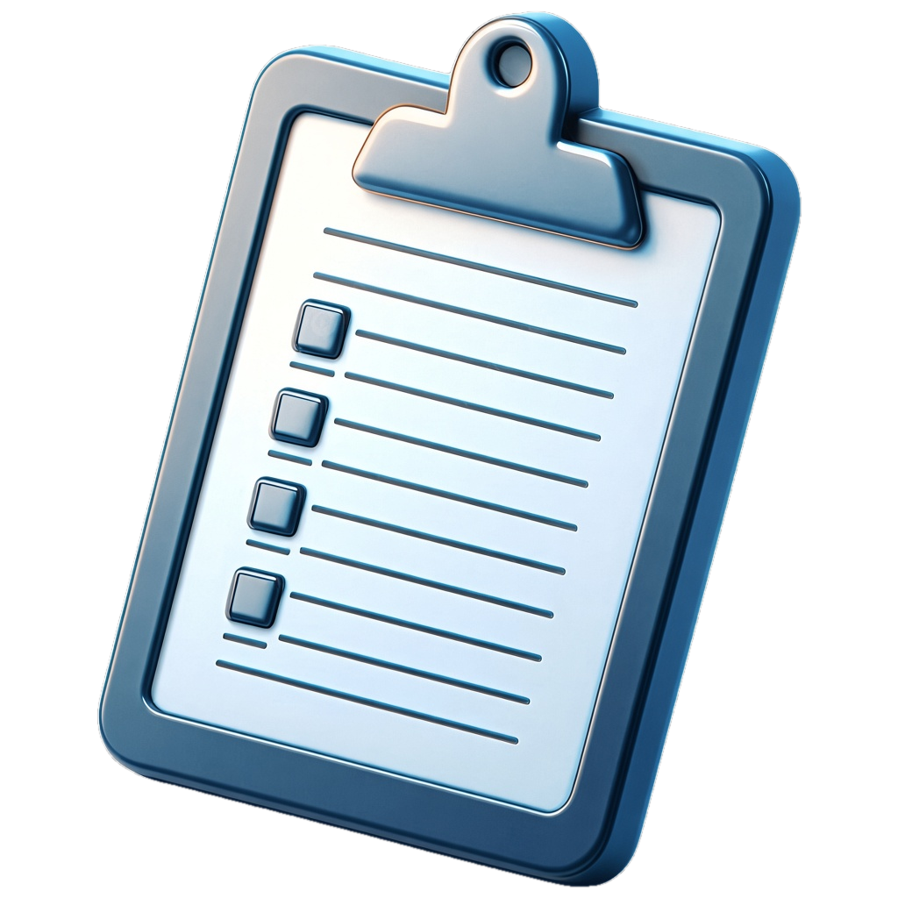

<p align="center">
  <picture>
    <source media="(prefers-color-scheme: dark)" srcset="art/header-dark.png" />
    
  </picture>
</p>

# Clipboard History

<p align="center"><strong>A history for your clipboard. Copy once, lose never.</strong></p>

<p align="center">
  A local Windows clipboard manager by <strong>Ohana Tech Solutions</strong> for finding, organizing, and reusing copied text and images.
</p>

<p align="center">
  
  
  <a href="LICENSE"></a>
  
</p>

---

##  Why This Exists

Copying something useful should not mean losing access to it the moment the clipboard changes. Clipboard History provides a searchable record of copied text and images within a familiar Windows desktop interface. Instead of depending on a cloud account, the app saves history locally under the current Windows user's account, with controls for selecting, editing, re-copying, and clearing entries.

<table width="100%">
  <tr>
    <td width="33%" valign="top" align="center">
      <p></p>
      <p><strong>The Problem</strong></p>
      <p>A standard clipboard holds the most recent copy for pasting. Once new material replaces it, retrieving an earlier excerpt, link, code snippet, or image can mean revisiting the original source.</p>
    </td>
    <td width="33%" valign="top" align="center">
      <p></p>
      <p><strong>The Purpose</strong></p>
      <p>Make repeatedly used clipboard material easy to find and reuse, without requiring an online account. Keep the workflow close to Windows, with practical search, organization, and direct control over saved history.</p>
    </td>
    <td width="33%" valign="top" align="center">
      <p></p>
      <p><strong>The Solution</strong></p>
      <p>Capture supported clipboard changes, store entries with timestamps in a locally encrypted history file, and provide filtering, one-click re-copy, editing for text, multi-selection, and targeted deletion from the desktop interface.</p>
    </td>
  </tr>
</table>

##  How It Works

1. **Capture:** While tracking is enabled, the app listens for Windows clipboard change notifications and reads supported text or image content.
2. **Classify:** Text is labeled as text, links, code, or hex colors based on content; image copies are saved as PNG data. Consecutive identical copies are skipped.
3. **Persist:** Entries and timestamps are serialized to a local file protected by Windows Data Protection API (DPAPI), scoped to the current user.
4. **Find and select:** Use the search field, type filter, checkbox multi-select, or Ctrl/Shift selection to work with saved entries.
5. **Reuse or remove:** Click a row to copy its full text or image back to the clipboard; edit text entries, delete selections, or clear history by time range.
6. **Keep running:** The notification-area icon toggles the window with a left click; its right-click menu offers exit. Optional Windows autostart is off by default.

**Privacy boundaries:** There are no application network calls, accounts, or cloud sync in the inspected source. DPAPI protects the saved file at rest but cannot prevent other programs running as the same Windows user from accessing live clipboard data. Sensitive clipboard content is **not automatically filtered**. See [Security and privacy](SECURITY.md).

##  Tech Stack

| Component | Technology | Role |
| :--- | :--- | :--- |
| Desktop application |  **C# / .NET 10** | Native Windows application logic and runtime |
| User interface | **Windows Presentation Foundation (WPF)** | Desktop window, searchable history, selection and dark-theme layout |
| Windows integration | **Win32 clipboard APIs + Windows Forms NotifyIcon** | Clipboard change notifications, tray icon and Windows integration |
| Local storage | **JSON + Windows DPAPI** | Per-user encrypted persistence and legacy-history migration |
| Windows packaging | **Inno Setup 6 + PowerShell** | Per-user installer, build automation and SHA-256 checksum |
| Continuous integration |  **GitHub Actions** | Windows build and installer artifact workflow |

##  Installation & Usage

### Windows requirements

- Windows **10 or 11, x64**, in a normal desktop user session.
- Installation is **per-user** and does not require administrator elevation.
- The packaged application is **self-contained**; installing the .NET SDK or Visual Studio is not necessary for ordinary use.

### Install the historical preview

1. Open [v1.2.2 legacy preview on GitHub Releases](https://github.com/ohanatechsolutions/Clipboard-History/releases/tag/v1.2.2-legacy-preview).
2. Download `OTS_Clipboard_History_Setup.exe` and its matching `.exe.sha256` file from **Assets**.
3. In PowerShell, verify the downloaded executable's checksum against the published checksum:

   ```powershell
   (Get-FileHash .\OTS_Clipboard_History_Setup.exe -Algorithm SHA256).Hash
   ```

4. After verifying the hash, run the installer and follow the Windows wizard.

> **Release caution:** This is an **unsigned historical pre-release**, not a production-certified build. A successful SHA-256 match checks file integrity against the published checksum, **not** publisher identity or malware safety. Clean-machine install, launch, tray, migration, and uninstall acceptance tests have not been signed off for this historical installer. See the [installer distribution audit](docs/INSTALLER_DISTRIBUTION_AUDIT.md).

### Everyday usage

| Action | How |
| :--- | :--- |
| Save a copy | Copy supported text or images in Windows while **Track clipboard** is enabled |
| Re-copy an entry | Left-click a history row, then paste with `Ctrl+V` |
| Find an entry | Search text or filter by clip category |
| Select multiple entries | Use checkboxes or `Ctrl`/`Shift` selection |
| Manage saved entries | Right-click to copy, edit text, select, deselect, or delete |
| Clear a time period | Use **Clear history ▾** and confirm the selected range |
| Pause collection | Turn off **Track clipboard** |
| Hide/show the window | Left-click the system tray icon |
| Fully stop the app | Right-click its tray icon and choose **Exit Clipboard History** |
| Start on sign-in | Enable the optional **Start with Windows** setting |

Closing or minimizing the window hides it to the tray; the app keeps monitoring until exited. Windows may put the icon in its hidden-icons area.

### Build from source

On Windows, install the [.NET 10 SDK](https://dotnet.microsoft.com/download/dotnet/10.0) and [Inno Setup 6](https://jrsoftware.org/isinfo.php), then clone or download this repository. From its root directory, run:

```powershell
powershell -ExecutionPolicy Bypass -File .\scripts\build-installer.ps1
```

The script restores and publishes the application, builds `dist/setup/Clipboard_History_Setup.exe`, and writes `dist/setup/Clipboard_History_Setup.exe.sha256`.

To start the application directly from source without installing it:

```powershell
dotnet run --project src/ClipboardHistory/ClipboardHistory.csproj
```

The [Windows installer workflow](.github/workflows/windows-installer.yml) also builds on eligible pushes to `main` and supports manual runs under **Actions → Build Windows installer → Run workflow**. Generated installers are workflow artifacts rather than files checked into the source tree. Workflow success does not replace hands-on Windows GUI testing.

### Storage, migration and limitations

- **History file:** `%LOCALAPPDATA%\OhanaTechSolutions\OTSClipboardHistory\history.dat`. Data is DPAPI-encrypted for the current Windows user.
- **Older installations:** The app can read the previous `%LOCALAPPDATA%\OhanaTechSolutions\OTSClipboard\history.dat` file and preserve the original while migrating data. Exit the older app before upgrading; verify migrated entries before deleting legacy data.
- **Capture limits:** Text longer than **2,000,000 characters** and PNG-encoded clipboard images larger than **5 MB** are skipped. Rich-text formatting and file-list copies are not captured.
- **Clipboard access:** Windows secure desktops and other applications that prevent clipboard reads cannot be monitored. There is no global hotkey.
- **Uninstall:** Use **Settings → Apps → Installed apps → Clipboard History**. Uninstalling does **not** delete the saved history file automatically.
- **Privacy:** This app does not clear Windows clipboard history, other apps' records, filesystem backups, or previously allocated storage. Pause tracking before copying secrets when appropriate.
- **Troubleshooting:** If new entries stop appearing, check **Track clipboard**, that the app is running in the tray, and the [security guidance](SECURITY.md). If an installer build fails, inspect its GitHub Actions job logs.

##  Branding

<p align="center">
  
</p>

The existing light/dark hero assets are in `art/`. The full-resolution transparent PNG above is the documentation and in-app branding asset; `src/ClipboardHistory/Resources/App.ico` is the Windows executable, window, installer and tray icon. Both are preserved unchanged.

*Actual application screenshots have not been added to this repository; no interface mockups are presented as verified screenshots.*

##  Roadmap & Verification

- [x] **Clipboard tracking:** Windows change notifications with text and image capture.
- [x] **History management:** Search, category filtering, re-copy, text editing, checkbox multi-select and deletion.
- [x] **Local persistence:** DPAPI-encrypted per-user history with backward-compatible migration logic.
- [x] **Tray integration:** Click-to-toggle window visibility and an explicit exit action.
- [x] **Installer pipeline:** PowerShell/Inno Setup recipe and a GitHub Actions Windows build workflow.
- [x] **Historical release:** v1.2.2 legacy preview published with a checksum; see [distribution evidence](docs/INSTALLER_DISTRIBUTION_AUDIT.md).
- [ ] **Release acceptance:** Complete and record clean-Windows installation, launch, tray, migration and uninstall tests for the historical installer.
- [ ] **Production signoff:** Obtain appropriate signing and independent release-security review before describing a build as production certified.

Checkboxes reflect inspected implementation and documented release-audit evidence—not a claim that all runtime behavior has been manually tested.

##  Acknowledgements

Built using Microsoft's **.NET / WPF** desktop platform and Windows APIs, with **Inno Setup** for packaging and **GitHub Actions** for automation. 

The project source is distributed under the [MIT License](LICENSE), © 2026 Ohana Tech Solutions.

---

<p align="center">
  <sub>Developed by <b>Ohana Tech Solutions</b>.</sub>
</p>
